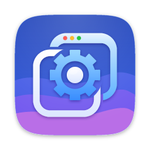

<p align="center"></p>

<h1 align="center">LiveWall</h1>

<p align="center">
  Videos, GIFs and images as your macOS desktop wallpaper, below the desktop icons, on every Space.
  A native app written in Rust, with hardware video decoding and no permission prompts.
</p>

<p align="center">
  
  
  <a href="LICENSE"></a>
</p>

<p align="center"><b>English</b> · <a href="README.ru.md">Русский</a></p>

## Requirements

- macOS 15 Sequoia or newer.
- A Mac with Apple Silicon (M1 or newer).
- Optional: [Homebrew](https://brew.sh). LiveWall uses it to install `ffmpeg` (for WebM, MKV, VP8 and AV1 on Macs
  without AV1 decoding) and `yt-dlp` + `deno` (for links). It asks before installing anything. MP4, MOV, GIF and
  images need nothing extra.

## Install

```bash
curl -fsSL https://raw.githubusercontent.com/BelHetile/LiveWall/main/scripts/install.sh | bash
```

The script downloads the latest release, checks it against the release's `SHA256SUMS.txt`, installs it to
`/Applications` and launches it. Run it again to update.

Or from the DMG:

1. Download `LiveWall.dmg` from the [latest release](https://github.com/BelHetile/LiveWall/releases/latest).
2. Open it and drag **LiveWall** to **Applications**.
3. LiveWall is not notarized, so macOS blocks the first launch. Open **System Settings → Privacy & Security**,
   scroll down and click **Open Anyway**. Alternatively run
   `xattr -dr com.apple.quarantine /Applications/LiveWall.app` once.

## Build from source

Needs the Command Line Tools (`xcode-select --install`) and [rustup](https://rustup.rs);
`rust-toolchain.toml` pins the Rust version.

```bash
git clone https://github.com/BelHetile/LiveWall.git
cd LiveWall
./scripts/build.sh --install
```

`./scripts/build.sh` alone builds `build/LiveWall.app` without installing it. See
[CONTRIBUTING](.github/CONTRIBUTING.md) for tests.

## Features

- **Wallpapers:** videos (mp4, mov, m4v, webm, mkv), animated GIFs and images (png, jpg, heic, webp, tiff, bmp),
  below the desktop icons on every Space, including full-screen app Spaces. One wallpaper for all desktops, or a
  different one per desktop (keys 1–9 in the library, ` for all).
- **Library:** add files and folders with a button or by drag & drop (files are copied into the library), or
  paste a video link (YouTube first; other sites [yt-dlp](https://github.com/yt-dlp/yt-dlp) supports may work).
  New files land in the folder you are viewing. Folders (created private right away if you like, renamed and
  deleted from the folder menu), search, grid and list views; Delete removes the wallpaper under the pointer.
- **Per-wallpaper settings:** **Fill, Fit, Stretch, Center** or **Custom** (position and zoom), volume, mute and
  playback speed. The inspector preview can play with sound while the desktop copy stays silent.
- **Transitions:** fade, wipe, wave, grow, directional sweeps and more between wallpapers, rendered on the GPU.
- **Optimize for This Mac:** videos are converted to HEVC at your screen's size with a frame-rate limit
  (VideoToolbox, HDR and 10-bit kept). New imports are optimized automatically when it helps; videos that are
  already light are left alone.
- **Smart pause:** playback pauses when an app is full screen, windows cover the desktop, the Mac runs in Low
  Power Mode or gets hot, another app is focused (optional), or an app from your own rules runs; it stops while
  the display sleeps, the screen is locked or the screen saver runs. The menu bar and the library toolbar show
  whether the wallpaper plays, is paused or unloaded and why, and whether sound is on, muted for this wallpaper or
  muted everywhere. A video paused long enough is unloaded and replaced by its exact paused frame. On battery
  the wallpaper keeps playing.
- **Lock screen:** the macOS desktop picture follows the wallpaper as a still frame, so the lock screen and
  Mission Control match. Pick the frame in the inspector, or choose a separate lock screen wallpaper. Your own
  desktop picture comes back when LiveWall quits, even after a crash.
- **Locked folders:** mark a folder as locked and its wallpapers disappear from the library, the menu bar and the
  lock screen until you unlock with Touch ID (or your Mac password); a private wallpaper already on the desktop
  keeps playing, unless *Settings → Privacy → Take Private Wallpapers off the Desktop* is on. They lock again
  when the screen locks, the display sleeps, after an idle time or with ⌃⌥⌘X. Optionally the folder itself is
  hidden too. This keeps wallpapers away from casual glances; the files are not encrypted.
- **Folder icons:** pick an SF Symbol or one of your own images for a folder (*Change Icon…* in the folder menu).
- **Rotation of the picture:** turn a video or image by 90° from the inspector or the context menu when a file
  carries the wrong orientation; videos are rewritten without re-encoding. Photo orientation (EXIF) is honoured.
- **Rotation:** change the wallpaper on a timer, in order or shuffled.
- **Hotkeys, menu bar and Dock:** global hotkeys, a menu bar item, launch at login. The Dock icon shows only
  while the library window is open, or never with *Settings → General → Show in Dock* off — LiveWall then
  lives in the menu bar only. Any wallpaper can have its own shortcut that switches the desktop, the lock
  screen or both to it and back again — also for wallpapers in locked folders.
- **Appearance:** light, dark or system; six color themes plus a custom accent. Save your own styles, and import
  or export them as `.livewall-style` files.
- **Languages:** the whole app is in English and Russian; switching the language in Settings applies at once.
- **Command line:** `lwctl` controls the running app (see below).

## Hotkeys

Change or clear them in **Settings → Shortcuts**:

| Action | Default |
| --- | --- |
| Next wallpaper | ⌃⌥⌘→ |
| Previous wallpaper | ⌃⌥⌘← |
| Random wallpaper | ⌃⌥⌘R |
| Pause / resume | ⌃⌥⌘Space |
| Mute / unmute | ⌃⌥⌘M |
| Volume up / down | ⌃⌥⌘↑ / ⌃⌥⌘↓ |
| Lock private folders | ⌃⌥⌘X |

Hotkeys need no permissions. Combinations macOS already uses are refused, and LiveWall says what uses them.

## Command line

`lwctl` is inside the app. Link it somewhere on your `PATH` if you like:

```bash
ln -s /Applications/LiveWall.app/Contents/MacOS/lwctl /usr/local/bin/lwctl
```

`lwctl [--json] <command>` talks to the running LiveWall. Exit codes: 0 ok, 1 error, 2 LiveWall not running,
64 usage error.

```
pause  resume  toggle-pause  mute  unmute  next  previous  random  lock
status  current  quit  spaces  windows  desktop  rules
library {list,add [--folder ID],remove,rename,move}
folder {create,rename,delete,lock,icon ID [symbol:NAME|image:FILE]}
rotate ID [--turns 1|2|3]
item-hotkey ID [COMBO] [--scope desktop|lock|both]
apply [--item ID] [--target default|space] [--target-id ID]
set-geometry ID --mode fill|fit|stretch|center|custom [--x N --y N --zoom N]
set-item ID [--volume N --speed N --muted BOOL --still-time N]
settings {get,set JSON}
hotkeys {get,set ACTION [COMBO]}
login-item {get,set BOOL}
menu  tools  tools-install TOOL [--consent]
probe PATH
download URL [--consent] [--no-wait]  download-status ID  download-cancel ID  downloads
optimize ID  optimize-status ID  optimize-cancel ID
```

`apply`, `next`, `previous` and `random` take a transition:

```
-t, --transition KIND   none simple fade left right top bottom wipe wave grow center any outer random
--duration SECONDS      default 1.0
--bezier A,B,C,D        default 0.54,0,0.34,0.99
--angle DEG             wipe/wave direction
--pos X,Y | ALIAS       circle origin: fractions, pixels or center/top-right/...
--invert-y              flip the y axis of --pos
--wave PERIOD,AMPLITUDE default 20,20
```

```bash
lwctl next -t wipe --angle 90 --duration 0.8
lwctl settings set '{"transition":{"kind":"grow","pos":"bottom-left"}}'
```

## Data

Everything lives in `~/Library/Application Support/LiveWall/`:

| Path | Contents |
| --- | --- |
| `library.json` | wallpapers, folders, what is shown where |
| `settings.json` | settings and hotkeys |
| `swap-state.json` | your original desktop pictures, while LiveWall replaces them |
| `Wallpapers/`, `Thumbs/`, `Stills/` | media, thumbnails, still frames |
| `private/` | the same for locked folders (hidden, owner-only) |
| `Incoming/` | downloads in progress |

## Uninstall

Quit LiveWall from the menu bar (this puts your desktop picture back), then delete
`/Applications/LiveWall.app`. To remove your wallpapers and settings too, delete
`~/Library/Application Support/LiveWall`.

## License

[MIT](LICENSE) © 2026 BelHetile
