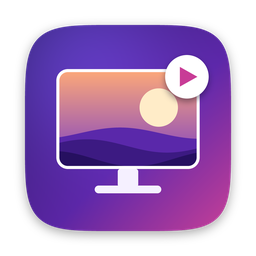

<p align="center"></p>

<h1 align="center">LiveWall</h1>

Menu bar app for macOS 13+: videos, images and GIFs as desktop wallpaper, per-wallpaper fill modes, global hotkeys.

## Download

Every push to `main` is built on macOS by GitHub Actions. Open the latest run in the **Actions** tab and download the
**LiveWall-macOS** artifact, unzip it and move `LiveWall.app` to `/Applications`
(first launch: right-click → Open, because the app is ad-hoc signed).

## Build from source

1. Install the Command Line Tools once: `xcode-select --install`
2. In this folder run:

```bash
chmod +x build.sh
./build.sh --install
```

This builds `build/LiveWall.app`, ad-hoc signs it, copies it to `/Applications` and launches it. Without `--install` the app stays in `build/`.

## Use

- The icon sits in the menu bar (no Dock icon). **Open LiveWall…** opens the library full screen; the gear in the top-right corner opens Settings.
- Add wallpapers:
  - **Add** — pick files or folders;
  - **Link** button (or just press **⌘V** with a link copied) — paste a direct link to a video/image, or a web page that has one (LiveWall looks for `og:video`, `<video>`/`<source>` and `og:image`);
  - drag files, folders or links from the browser into the window.

  Supported: mp4 / mov / m4v (H.264, HEVC), png / jpg / heic / webp, gif. Files are stored in `~/Library/Application Support/LiveWall/`.
- **Folders**: create folders under the "Now" row, drag wallpapers onto them (or use *Move to Folder*), rename them and give them an icon from the built-in pack (50+ icons × 8 colors) or your own image. Folders also appear as submenus in the menu bar.
- **Rename** wallpapers and folders by double-clicking the name, from the context menu or with the pencil button.
- **Locked folders**: right-click a folder → *Set Password…*. Its wallpapers disappear from the library, the menu bar, Next / Previous / Random and auto-rotation until you unlock it. Folders lock again when you close the window, lock the screen or the Mac goes to sleep. Passwords are stored only as a salted PBKDF2-SHA256 hash and can't be recovered. Note: this hides wallpapers inside LiveWall; the files themselves are not encrypted on disk.
- **Per-wallpaper hotkey**: no wallpaper has a hotkey until you set one in its panel. Press it once to switch to that wallpaper, press it again to go back to the one that was on before. Hotkeys of wallpapers in locked folders work without entering the password; while such a wallpaper is on, LiveWall shows it as "Private wallpaper".
- Click a wallpaper to open its panel: put it on the **Desktop** or the **Lock Screen**, pause, set its own volume and speed, choose the fill mode (**Fill, Fit, Stretch, Center**).
- Settings: default playback, smart pause, app rules, lock screen, auto-rotation, launch at login, hotkeys.

## Smart pause (like Wallpaper Engine's Performance settings)

Video pauses automatically when:
- another app is focused (off by default),
- windows cover ≥90% of the desktop (maximized apps),
- an app is in fullscreen,
- on battery (off by default), in Low Power Mode, or when the Mac is running hot,
- an app from **App rules** is running or in front (e.g. games),
- the display sleeps or the screen is locked (always).

The current reason is shown in the window toolbar and in the menu bar menu.

## Lock screen

macOS does not let third-party apps show live video on the lock screen. LiveWall sets a still frame of the
current wallpaper as the system wallpaper, which the lock screen shows. It is re-applied when you switch
wallpapers, change fill mode or switch Spaces.

## Default hotkeys (all rebindable in Settings)

| Action | Keys |
| --- | --- |
| Next wallpaper | ⌃⌥⌘→ |
| Previous wallpaper | ⌃⌥⌘← |
| Random wallpaper | ⌃⌥⌘R |
| Pause / resume video | ⌃⌥⌘Space |
| Cycle fill mode | ⌃⌥⌘M |
| Mute / unmute | ⌃⌥⌘S |
| Open library | ⌃⌥⌘L |

## Notes

- The wallpaper is a borderless window just above the system wallpaper and below desktop icons, on every Space and every display.
- Videos play muted by default and without keeping the screen awake.
- Wallpaper Engine `scene.pkg` files cannot be loaded directly: render them to mp4 first.
